<!-- _class: lead hero -->
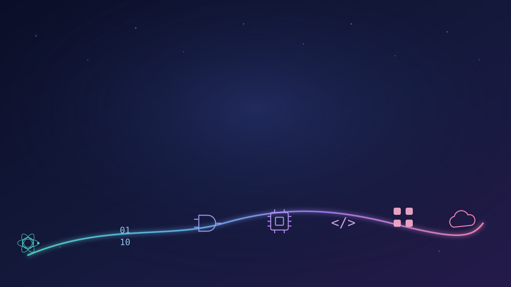
# From Electrons to Apps
## Levels of Abstraction in Computing

A 1-hour journey from physics to the apps you use every day

<!-- Next: What actually happens when you double-click an icon? -->

---

## 🚀 What actually happens when you double-click an icon?

- Somewhere, **electrons** start moving in a very specific pattern
- Today we zoom all the way down to those electrons — then climb back up,
  floor by floor, to the app on your screen (and even "the cloud")
- **No prior programming knowledge needed — just curiosity**
- By the end, you'll be able to follow the path from "electron" to "app opens"

<!-- Next: The Abstraction Tower 🗼

Spoiler for later: the cloud is just someone else's computer. -->

---

## The Abstraction Tower 🗼

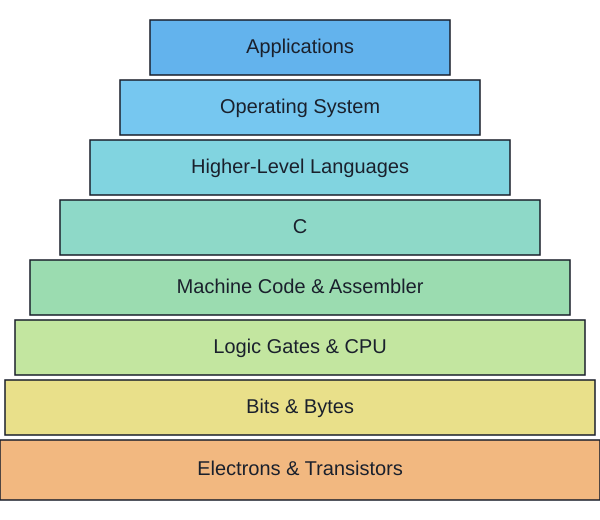

We'll climb it floor by floor:

1. Electrons & Transistors
2. Bits & Bytes
3. Logic Gates → CPU
4. Machine Code & Assembler
5. C — the "portable assembler"
6. Higher-Level Languages
7. Operating Systems
8. User Applications
9. Bonus: The Cloud

<!-- Next: 1. Electrons & Transistors -->

---

<!-- _class: lead -->
# 1. Electrons & Transistors
### Floor 1 — Physics

Where does it all begin?

<!-- Next: It starts with electricity -->

---

## It starts with electricity

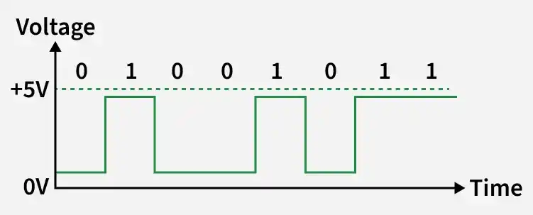

- Electricity = electrons flowing through a wire
- We can measure it as **voltage**: high voltage or low voltage
- Computers only care about **two states**: voltage present or not
  - High voltage → **1**
  - Low voltage → **0**

*A stream of 1s and 0s is really just voltage switching high and low over time*

<!-- Next: The transistor: a switch controlled by electricity -->

---

## The transistor: a switch controlled by electricity

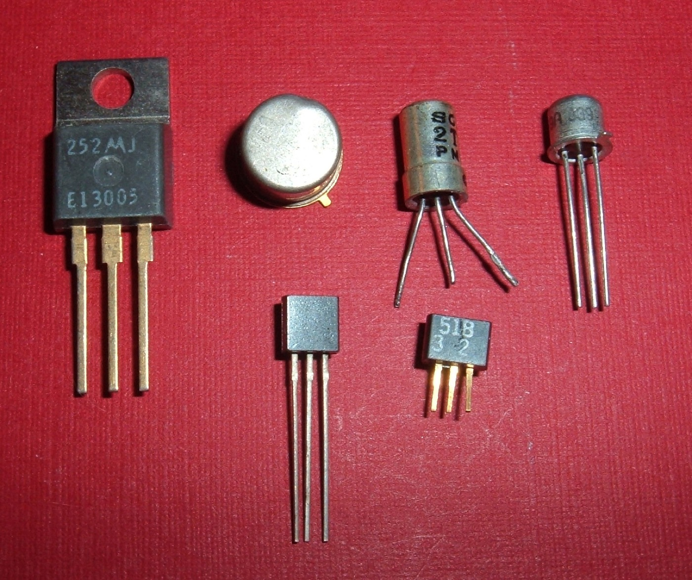

- A transistor is a tiny switch
- Normally, switches are flipped by hand (light switch)
- A transistor is flipped by **another electrical signal**
- This means: *electricity can control electricity*

*Photo: real discrete transistors — modern chips shrink these to billions per chip*

<!-- Next: Why does that matter? -->

---

## Why does that matter?

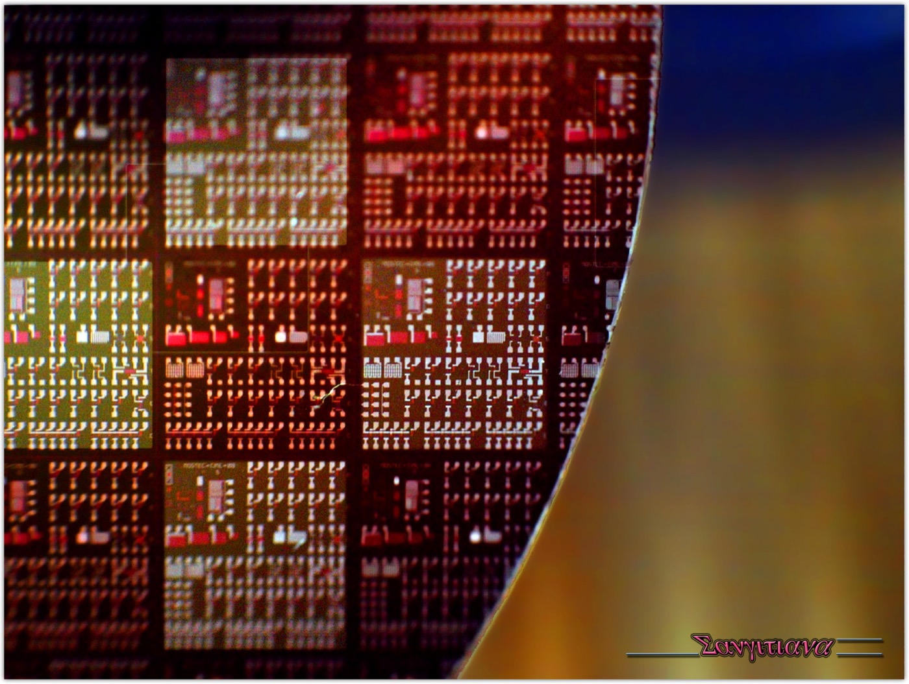

- If one signal can turn another on/off...
- ...we can chain millions of them together
- Each transistor makes a tiny **decision**: pass current, or don't

**Key idea:** physics gives us a reliable on/off switch.

*Photo: a silicon wafer — each square becomes a chip with billions of transistors*

<!-- Next: 2. Bits & Bytes -->

---

<!-- _class: lead -->
# 2. Bits & Bytes
### Floor 2 — Representing Information

How do on/off signals become *information*?

*A glass of water is neither half full nor half empty — it just is as it is.
It's humans who give it meaning. The same wire is just carrying electricity —
it's humans who agree to call high voltage "1" and low voltage "0".*

<!-- Next: The bit

Bridge: we just built transistors — switches that turn electricity into a
reliable yes/no signal. What do we actually do with billions of these
signals? We group them into bits and bytes to represent real information:
numbers, letters, colors, sound. -->

---

## The bit

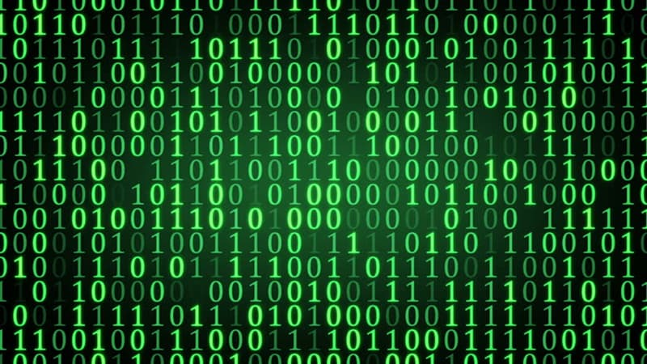

- **Bit** = one on/off signal = one 0 or one 1
- The smallest unit of information a computer can store

🙋 **Try it:** count to 5 on one hand in binary —
finger up = 1, finger down = 0 (5 = `101`)

<!-- Next: The byte

Activity: rightmost finger = 1, next = 2, next = 4. 1 = thumb, 2 = index,
3 = thumb + index, 4 = middle, 5 = thumb + middle. Five fingers count to 31. -->

---

## The byte

- **Byte** = a group of 8 bits
- Example: `0000 0001`
- A single byte can represent 256 different values (0–255)

```
0000 0000  = 0
0000 0001  = 1
0000 0010  = 2
0000 0011  = 3
...
1111 1111  = 255
```

<!-- Next: Why binary, not decimal? -->

---

## Why binary, not decimal?

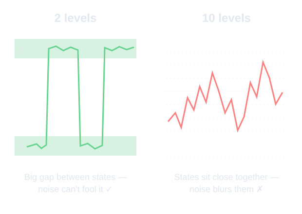

- Building a reliable switch with exactly 2 states (on/off) is easy
- Building a reliable switch with 10 states would be very hard —
  electrical noise blurs neighbouring levels
- Binary isn't a choice for convenience — it's a choice for **reliability**

<!-- Next: Bits represent everything

😄 Joke — There are 10 types of people in the world: those who understand
binary, and those who don't. -->

---

## Bits represent *everything*

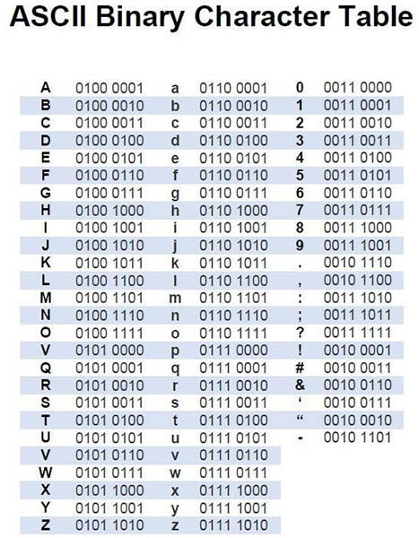

- Numbers → straightforward binary counting
- Letters → each letter mapped to a number (e.g. ASCII: 'A' = 65)
- Colors → red/green/blue values as numbers
- Sound → sampled amplitude values, thousands of times per second

**Key idea:** bits don't "know" what they mean — the program interpreting them decides.

<!-- Next: 3. Logic Gates → CPU -->

---

<!-- _class: lead -->
# 3. Logic Gates → CPU
### Floor 3 — Building a Calculator from Switches

Storing information is nice — but how do we *compute* with it?

<!-- Next: From switches to logic gates

Bridge: bits and bytes let us represent numbers, letters, colors, sound.
But how do we calculate with them — add two numbers, compare them, move
them around? We wire transistors into logic gates, and gates into circuits
that compute. That's how a CPU is built. -->

---

## From switches to logic gates

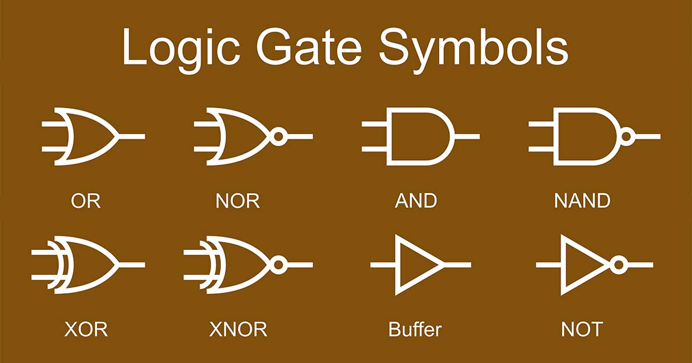

- Combine a few transistors → build a **logic gate**
- Logic gates: AND, OR, NOT (and friends like XOR)
  - AND → 1 only if *both* inputs are 1
  - OR → 1 if *either* input is 1
  - NOT → flips the bit

**Key idea:** a gate is a tiny decision-maker working on bits.

*Video: [a 1-minute visual explainer of logic gates](https://www.youtube.com/shorts/VJ3Xc52vRwg)*

<!-- Next: Combining gates: an adder

If there is no internet: skip the video and walk through the gate symbols
in the image instead. -->

---

## Combining gates: an adder

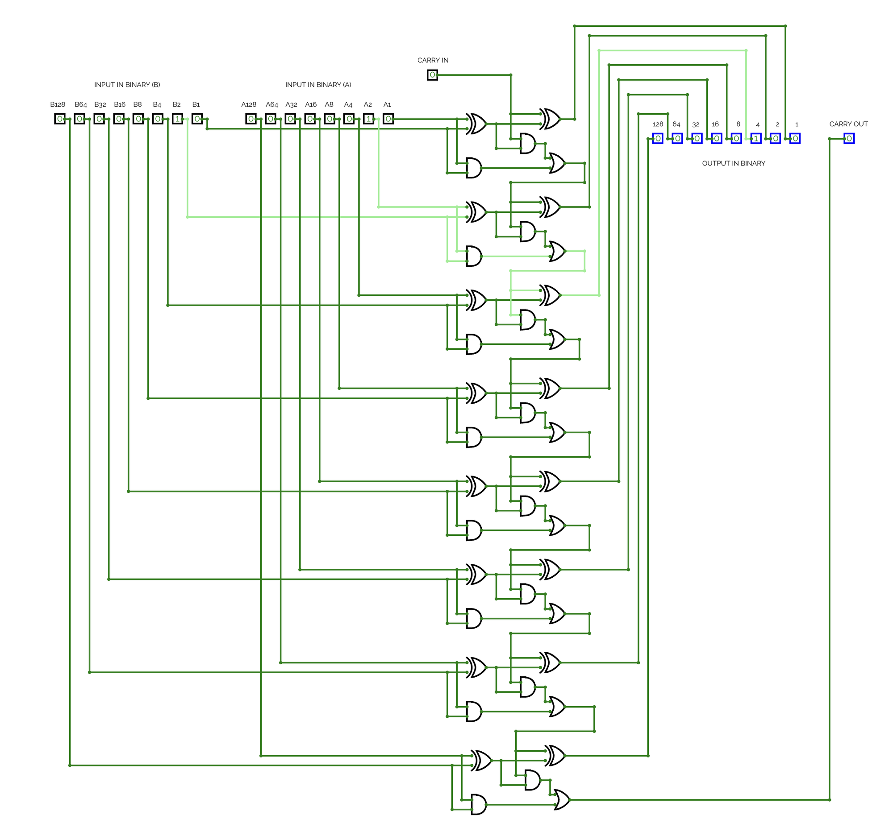

- Adding two bits: 1 + 1 = `10` → sum 0, carry 1
- **XOR** gate → the sum bit, **AND** gate → the carry bit
  (a "half adder")
- Also accept a carry-in → a "full adder"
- Chain 8 full adders → a circuit that adds whole bytes (shown here)

<!-- Next: Zoom out: millions of these -->

---

## Zoom out: millions of these

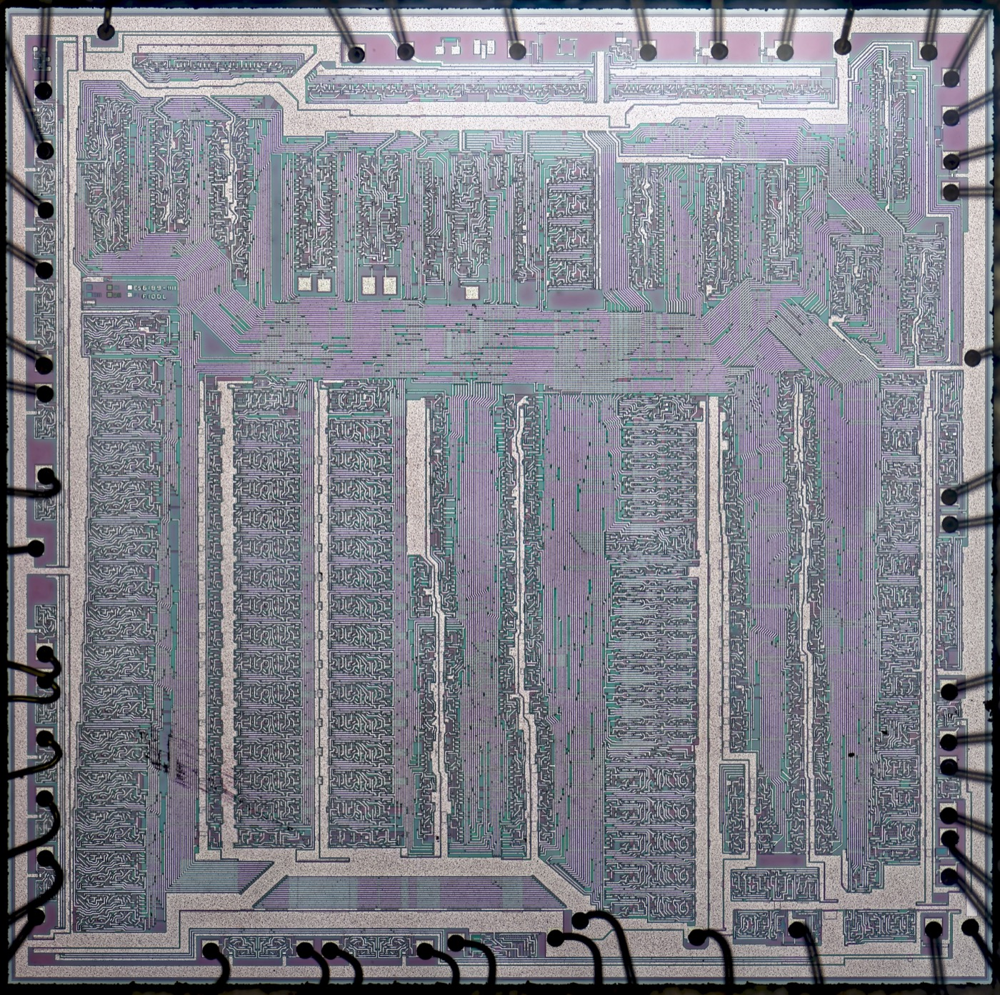

- Wider adders → add 32- or 64-bit numbers
- Add more circuits → multiply, compare, move data around
- Package **millions to billions** of transistors into one chip

**That chip is the CPU.**

*Photo: a real microprocessor die, magnified — every rectangle is functional circuitry*

<!-- Next: Three more ingredients -->

---

## Three more ingredients

- **Registers** — tiny, extremely fast storage slots inside the CPU
- **Memory (RAM)** — outside the CPU; holds the program's instructions
  *and* its data
- **Clock** — a ticking signal that paces every step
  (modern CPUs tick billions of times per second — GHz)

On every tick, the CPU repeats: **fetch** an instruction from memory →
**decode** it → **execute** it

**Key idea:** the CPU is a huge, fast calculator made entirely of on/off switches.

<!-- Next: 4. Machine Code & Assembler -->

---

<!-- _class: lead -->
# 4. Machine Code & Assembler
### Floor 4 — Talking to the CPU

A calculator alone does nothing — how do we *tell* it what to do?

<!-- Next: Machine code

Bridge: we built a CPU — millions of gates, registers, memory and a clock,
able to do arithmetic on bits. We give it a sequence of instructions it
understands: machine code, written more conveniently via assembler. -->

---

## Machine code

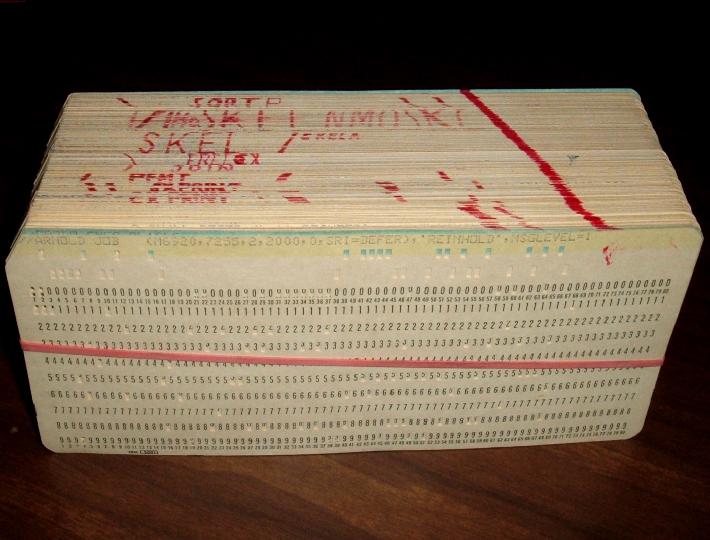

- The CPU only understands raw binary instructions
- Example (simplified): `10110000 01100001`
  → "put the value 97 into register A"
- Every CPU family has its own machine code "dialect"

*Photo: a punched card deck — an early, physical way of feeding instructions to a computer*

<!-- Next: ⚠️ Data and instructions look identical -->

---

## ⚠️ Data and instructions look identical

- Memory just stores **bytes** — `01100001` could mean:
  - the number 97
  - the letter `a`
  - or part of a machine instruction
- The CPU doesn't "know" which one it is — *context* decides
- Programs and data live in the **same memory**, side by side

**If a program mistakes data for instructions** (or vice versa), the CPU
happily executes whatever garbage bytes it finds — often ending in a crash
or an infinite loop, i.e. the computer **freezes**

*This mix-up is also the root cause of classic security bugs like buffer overflows*

<!-- Next: Assembler: a thin translation layer -->

---

## Assembler: a thin translation layer

- Machine code is unreadable for humans
- **Assembly language** gives instructions short names:

```asm
MOV A, 97   ; put 97 into register A
ADD A, B    ; add register B to register A
JMP loop    ; jump back to "loop"
```

- Each assembly line maps almost 1:1 to one machine code instruction

**Key idea:** assembler is a direct, human-readable translation of machine code.

<!-- Next: 5. C — the "Portable Assembler" -->

---

<!-- _class: lead -->
# 5. C — the "Portable Assembler"
### Floor 5 — Structured, Reusable Code

What if we could write code once and run it on many CPUs?

<!-- Next: The problem with assembly

Bridge: assembler maps almost 1:1 to machine code — but only for one
specific CPU type, and it's tedious to write. We introduce a language with
structure — variables, functions, loops — that a compiler translates to
whichever CPU's machine code we need. -->

---

## The problem with assembly


- Tied to *one specific* CPU type
- Extremely tedious to write
- Very easy to make mistakes (no safety nets)

<!-- Next: Enter C

😄 Joke — Assembly programmers are the people who hike without GPS or trail
markers and insist it builds character. C came along and said: maybe a
trail map wouldn't hurt. -->

---

## Enter C

```c
int add(int a, int b) {
    return a + b;
}
```

- Introduces **variables**, **functions**, **loops** as readable text
- Still maps closely to what the machine actually does
- Nicknamed "portable assembler" — same ideas, works on many CPUs

<!-- Next: The compiler -->

---

## The compiler

- A program that translates C source code → machine code
- Different compiler per target CPU, same C source code
- This is what makes C "portable"

<!-- Next: Source code vs. the executable -->

---

## Source code vs. the executable

<style scoped>
section { font-size: 24px; }
</style>
- **Source code** (`add.c`) is a text file — human-readable, editable,
  means nothing to the CPU on its own
- The **compiler** reads it and produces a **binary executable**
  (`add.exe`, `add`, or similar) — pure machine code, ready for the CPU
- They are **completely different files**:

| | Source code | Executable |
|---|---|---|
| Format | plain text | binary (machine code) |
| Readable by | humans (and editors) | the CPU |
| Can you run / edit it? | no / yes | yes / not really |

- Edit the `.c` file → you must **recompile** to get an updated binary
- An executable is built for one CPU **and** one OS — a Windows `.exe`
  won't run on a Mac

<!-- Next: Where C lives today

😄 Joke — Forgetting to recompile after editing your code is the programming
equivalent of changing the recipe but serving yesterday's cake. -->

---

## Where C lives today

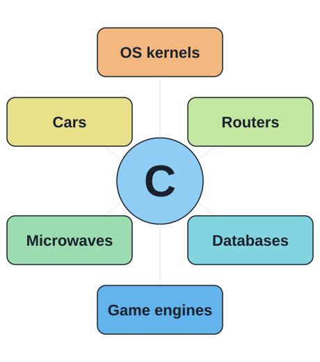

- Operating system kernels (Linux, parts of Windows/macOS)
- Embedded systems (microwaves, cars, routers)
- Performance-critical software (databases, game engines)

<!-- Next: 6. Higher-Level Languages -->

---

<!-- _class: lead -->
# 6. Higher-Level Languages
### Floor 6 — Closer to Human Thinking

Can code read more like plain thinking?

<!-- Next: The problem C still has

Bridge: C is portable and structured, but you still manage memory yourself,
and it takes a lot of code to express simple ideas. Higher-level languages —
Python, JavaScript, Java and many more — trade a little control for a lot
of readability and speed of development. -->

---

## The problem C still has

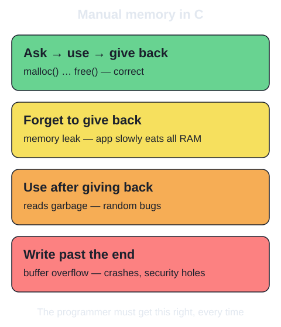

- You manage memory yourself — easy to get wrong
- Verbose — lots of code for simple ideas
- Still thinking like the machine, not like a human

<!-- Next: Higher-level languages -->

---

## Higher-level languages

- Python, JavaScript, Java, and many others
- Automatic memory management — the language cleans up after you
- Rich ecosystems: huge libraries for almost any task
- Example — same idea as our C function, in Python:

```python
def add(a, b):
    return a + b
```

<!-- Next: Compiled vs. interpreted (just the vocabulary)

😄 Joke — In C, managing memory yourself is like being responsible for
cleaning up every room you ever walk into, forever. Higher-level languages
hired you a cleaning service — it's called garbage collection. -->

---

## Compiled vs. interpreted (just the vocabulary)

- Some languages are **compiled ahead of time** (like C)
- Some languages are **interpreted** — translated and run on the fly
- Many modern languages do a mix of both

**Key idea:** every layer trades a bit of performance/control for speed of writing and readability.

<!-- Next: 7. Operating Systems

😄 Joke — Compiled languages translate the whole book before you start
reading. Interpreted languages translate it sentence by sentence while you
read — slower, but great if you keep changing your mind about the plot. -->

---

<!-- _class: lead -->
# 7. Operating Systems
### Floor 7 — Sharing the Machine

Many programs, one machine — who's in charge?

<!-- Next: What does an OS actually do?

Bridge: your computer runs many programs at once (browser, music, this
slideshow). Who decides which one gets the CPU, memory and screen right
now? The operating system — it manages the hardware and shares it safely
between every running program. -->

---

## What does an OS actually do?

- Manages the hardware: CPU, memory, disk, screen, network
- Shares that hardware safely between **many** running programs
- Without it, every app would need to know how to talk to every device directly

<!-- Next: A few key concepts -->

---

## A few key concepts

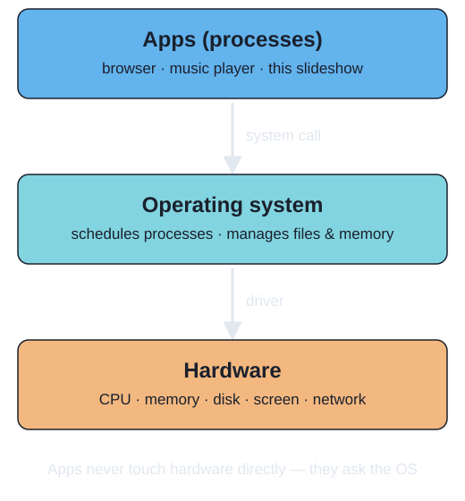

- **Process** — a running program, with its own slice of memory and CPU time
- **File** — a named chunk of data stored on disk, managed by the OS
- **System call** — how an app asks the OS for something
  ("open this file", "send this over the network")
- **Driver** — software that lets the OS talk to specific hardware

<!-- Next: Same idea, different implementations -->

---

## Same idea, different implementations


- **Windows**, **macOS**, **Linux** (and Android, which is built on Linux)
- All solve the same core problems: process management, files, drivers, security
- Different design choices, same fundamental job

*Tux the penguin — mascot of the Linux kernel*

<!-- Next: 🎥 Demo: seeing processes live -->

---

## 🎥 Demo: seeing processes live

🙋 **Guess first:** how many processes are running on this laptop right now?

- Open Task Manager (Windows) or Activity Monitor (macOS)
- Point out: dozens — often hundreds — of processes running *right now*
- This is the OS doing its job, visibly, in real time

<!-- Next: 8. User Applications

Collect a few guesses (by show of hands) before opening the tool. -->

---

<!-- _class: lead -->
# 8. User Applications
### Floor 8 — What You Actually See

So what *are* all those programs, from your point of view?

<!-- Next: Apps are built on everything below

Bridge: the OS manages processes, files and drivers. The programs it runs
are the applications — the browser, the game, the word processor —
everything you actually click on and use. -->

---

## Apps are built on everything below

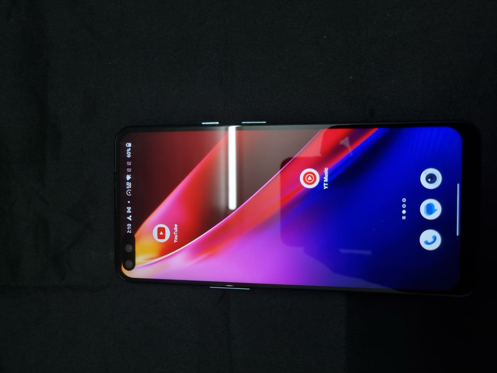

- A browser, a game, a word processor:
  - Written in a higher-level language (or C/C++)
  - Compiled/interpreted down through the layers
  - Uses OS services (files, network, screen, input)
  - Ultimately runs as CPU instructions
  - Which are, in the end, electrons flipping switches — billions of times per second

<!-- Next: Full circle 🔄 -->

---

## Full circle 🔄

**Double-click icon**
→ OS loads the program into memory
→ CPU starts executing its instructions
→ Instructions are just patterns of bits
→ Bits are just voltage levels
→ Voltage levels are just electrons moving through transistors

<!-- Next: 9. The Cloud -->

---

<!-- _class: lead -->
# 9. The Cloud
### Bonus Floor — Computers Running Somewhere Else

Many apps clearly involve *other* computers — where are they?

<!-- Next: Wait — does the app run on my computer?

Bridge: on your device, apps run all the way down to electrons — a
complete, self-contained tower. But weather, chat and video involve other
computers too. Those live in data centers — what everyone calls "the
cloud". -->

---

## Wait — does the app run on *my* computer?

- Often, only part of it does
- When you check the weather, chat, or stream a video, your device sends a
  request over the internet
- That request is handled by **another computer**, somewhere else entirely
- On the way, the same bits travel as electrical pulses, light in
  fiber-optic cables, or radio waves (Wi-Fi, 5G)

<!-- Next: So what is "the cloud"? -->

---

## So what *is* "the cloud"?

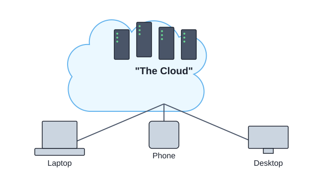

- Not a mystical thing floating above us
- It's just **someone else's computers** — running in a building far away
- Same electrons, same transistors, same CPU, same OS, same apps we just learned about
- The only difference: it's not sitting on your desk

<!-- Next: Inside a data center -->

---

## Inside a data center

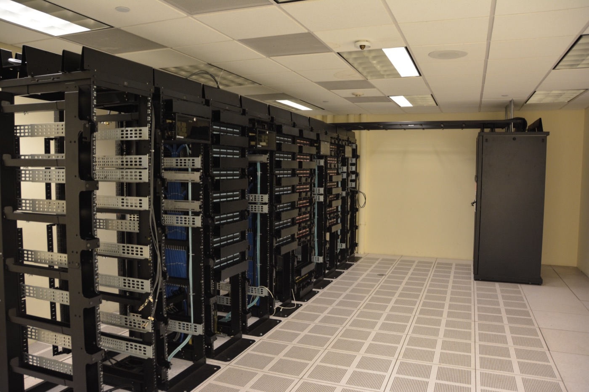

- Warehouses full of **racks** of computers
- Each rack holds many servers, each server has CPUs, memory, storage — exactly
  like the machine on your desk, just bigger and more of them
- Owned by companies (Amazon, Google, Microsoft, etc.) who rent out computing
  power to others

<!-- Next: Why use someone else's computer? -->

---

## Why use someone else's computer?

- **Scale** — instantly use 1 computer or 10,000, only when you need them
- **Maintenance** — someone else keeps the hardware running, updated, and cooled
- **Access anywhere** — your data/app is reachable from any device, anywhere
- **Cost** — pay only for what you use, instead of buying your own hardware

<!-- Next: Same tower, just far away 🔁 -->

---

## Same tower, just far away 🔁

- Your phone/laptop is still climbing its own tower: apps → OS → CPU → bits → electrons
- It just also **talks to another tower**, in a data center, over a network
- "The cloud" = a lot of familiar towers, networked together, out of sight

<!-- Next: Putting It All Together -->

---

<!-- _class: lead -->
# Putting It All Together

Let's walk back through the whole tower in one breath

<!-- Next: The full ladder, one line each

So it clicks as a single connected idea rather than nine separate ones. -->

---

## The full ladder, one line each

1. **Electrons** flow through **transistors** (switches)
2. On/off signals become **bits & bytes**
3. Transistors form **logic gates**, gates form a **CPU**
4. The CPU executes **machine code**, written via **assembler**
5. **C** gives structure while staying close to the machine
6. **Higher-level languages** let us think more like humans
7. The **operating system** shares hardware between programs
8. **Applications** are what we actually see and use
9. **The cloud** is just more of these towers, somewhere else

<!-- Next: Programmers can choose which floor of this tower to work on — or several. -->

---

<!-- _class: lead -->
# Programmers can choose which floor of this tower to work on — or several.

## Questions?

<!-- Next: Image Credits -->

---

## Image Credits

- Diagrams (tower, cloud, hero title, hero background, binary levels, OS
  layers, C uses, memory problems): original, made for this deck
- Logic gate symbols, voltage signal, binary background, ASCII table, 8-bit
  adder circuit: provided by the presenter
- Transistors, silicon wafer, CPU die, punched cards: ArnoldReinhold /
  Sangitiana Fararano / Revaldinho — CC BY / CC BY-SA, Wikimedia Commons
- Keyboard, smartphone, data center: Jovonni Pharr / Gannu03 / Carl Lender —
  CC BY / CC BY-SA, Wikimedia Commons
- Tux: Larry Ewing / Simon Budig / Anja Gerwinski, Wikimedia Commons

*(full details in `images/CREDITS.md`)*
